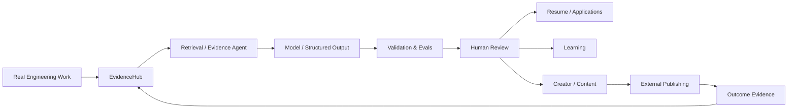

# SoloScale AI OS

**A local-first, human-controlled applied AI workflow system for turning real engineering work into verified evidence, learning workflows, job artifacts, and publishable proof.**

[**Watch the Hero Demo →**](https://soloscale-showcase.vercel.app/showcase/soloscale-hero-demo-v1)

> Current package: `0.4.2` · Python `3.11+` · Local-first · Human-controlled

**Closeout scope:** local operator workflows, the existing public Showcase, and a
provenance-matched macOS candidate. See [current delivery gate](TASK.md) and
[verification and release procedure](docs/engineering/closeout-0.4.2.md). The hosted
Resume service is locally evaluated; AWS deployment is deferred. A generated DOCX
still requires content review before application use.

The current operator priority is job-search outcomes: applications, interviews, and offers.
Learning and building proceed in parallel, while real recruiting feedback chooses the next
slice. Code existence, personal mastery, and interview ability are separate states; missing
evidence remains unknown.

**Engineering signals:** agentic workflows · RAG / evidence retrieval · structured model outputs · deterministic validation · provider routing · OAuth integrations · CLI / local UI / macOS · Python quality tooling: pytest · Ruff · mypy

---

## What this repository demonstrates

| Engineering area | SoloScale implementation |
| --- | --- |
| Agentic workflows | Bounded planner, executor, reviewer, and human-gate contracts with deterministic state and receipts outside the model |
| State & recovery | Explicit state transitions, persisted run continuity, bounded model/retrieval retries, timeouts, completion checks, and approval receipts |
| RAG / evidence | Local SQLite + FTS knowledge index, bounded retrieval, evidence citations, hash lineage, and claim validation |
| Structured AI outputs | Pydantic-validated model contracts keep generated candidates separate from verified facts and approved outputs |
| Evaluation | Synthetic retrieval/context gates plus citation-lineage, schema, packaging, and deterministic acceptance checks |
| Provider routing | Local Ollama, explicit OpenAI-compatible and DeepSeek structured-output paths, a hosted gateway, and optional local MLX—with no implicit provider fallback |
| Human-in-the-loop AI | Public, paid, destructive, credential, and irreversible actions remain explicitly gated |
| Developer tooling | Python package, CLI, local web UI, versioned Skills, receipts, and inspectable run artifacts |
| Productization | Optional native macOS desktop app and Remotion / TypeScript video-rendering surfaces |
| External integrations | YouTube OAuth/upload, read-only GitHub metadata, LinkedIn/X handoffs, and a paid-operation-gated HeyGen provider |
| Quality tooling | pytest, Ruff, strict mypy configuration, deterministic checks, and package/build tooling |

## Measured results

| What was measured | Result | Source |
| --- | --- | --- |
| Resume cloud service under concurrent load (local machine, 2 API processes, 2 workers with 2 model slots each, fake model gateway, PostgreSQL 16) | 91 `POST /tasks` requests; 48 idempotent replays returned the original task; 8 over-limit requests got `429`; 0 duplicate terminal events; total model concurrency peaked at 4 of the configured bound of 4 | [Concurrency evaluation, 2026-11-01](docs/evaluations/resume-cloud-concurrency-2026-11-01.md) |
| 0.4.2 release gate | 720 passed / 10 skipped, Ruff, strict mypy, wheel and sdist build | [TASK.md](TASK.md), [closeout-0.4.2](docs/engineering/closeout-0.4.2.md) |
| macOS desktop startup | The app and its bundled Python backend check each other with HMAC-SHA256 over a per-launch secret, bound to the loopback origin, process ID and a nonce; the session cookie is accepted only when the proof matches | [DesktopBootstrap.swift](desktop/macos/Sources/SoloScaleDesktopCore/DesktopBootstrap.swift) |

These are synthetic, local measurements. They do not describe paid upstream or production capacity.

---

## Why SoloScale exists

Most AI demos stop when the model returns an answer.

Real AI products have to handle everything around that answer:

* What evidence was retrieved?
* What is the model allowed to infer?
* What happens when a step fails?
* Who owns retries and state transitions?
* How is an output validated?
* When should a human approve an external action?
* How can real engineering work become reusable evidence instead of disappearing after the task is complete?

SoloScale is my exploration of those applied AI engineering problems.

Instead of giving an autonomous agent unlimited control, **code owns the execution loop** while models operate inside bounded roles.

```text
REAL WORK
   ↓
EVIDENCE / RETRIEVAL
   ↓
MODEL REASONING
   ↓
VALIDATION / EVAL
   ↓
HUMAN REVIEW
   ↓
RESUME · LEARNING · CONTENT · EXTERNAL ACTION
```

---

## Current product surface

### Work & Evidence

SoloScale captures structured evidence from real engineering activity and turns it into reusable inputs for downstream workflows.

The local Evidence system combines:

* engineering artifacts
* Git metadata
* local Codex session data
* operator-supplied ChatGPT exports
* project runs and validation artifacts
* external outcome metadata

Retrieval is bounded and treated as untrusted input. Retrieved text can support reasoning, but retrieval alone does not authorize a public claim.

### Resume & Applications

A job description plus an operator-supplied candidate profile can produce:

* targeted resume drafts
* skill–evidence graphs
* explicit evidence gaps
* reviewable application bundles

Candidate facts remain separate from retrieval candidates.

The current `/resume/intelligence` route is a local **preflight candidate**: it
analyzes the JD, retrieves only the evidence sources selected for that run, grades
claim truth, and prepares a generation contract without making a provider call.
Private Codex/ChatGPT and BuildLog history are excluded by default. The existing
`/resume` route remains the active generation/export path; connecting the candidate
generator and recovering from provider length/schema failures are separate follow-up
work, not completed capabilities in this revision.

### Engineering Learning

Resolved engineering work can become structured interview practice through:

```text
Explain → Trace → Rebuild → Debug → Defend
```

Completing software work does not automatically imply human mastery.

### Creator & Content

Verified engineering evidence can be transformed into reviewable:

* LinkedIn drafts
* X threads
* technical stories
* diagrams
* video/storyboard packages

External publication remains human-controlled.

---

## Architecture



The model helps reason and generate.

**Code owns control flow.**

State transitions, retry budgets, timeouts, approvals, validation, and completion checks remain deterministic.

---

## Tech stack

### Core

* Python 3.11+
* Pydantic
* Typer
* Rich
* SQLite + FTS
* pytest
* Ruff
* strict mypy

### AI / model integrations

* Ollama
* MLX
* configurable OpenAI-compatible endpoints
* DeepSeek structured outputs
* hosted provider gateway
* structured model outputs

### External integrations

* Google / YouTube OAuth and upload
* LinkedIn / X handoffs through BuildLog
* read-only GitHub metadata
* HeyGen behind an explicit paid-operation gate

BuildLog is a separate downstream project and is not vendored in this repository. SoloScale keeps only the adapter and handoff boundary needed to stage compatible publishing workflows.

### Product surfaces

* Python package
* CLI
* local web UI
* native macOS desktop app
* Remotion / TypeScript video rendering

---

## Hero Demo

The public Hero Demo shows the product workflow rather than only describing the architecture.

**[Open SoloScale Hero Demo v1 →](https://soloscale-showcase.vercel.app/showcase/soloscale-hero-demo-v1)**

---

## Quick start

```bash
python3 -m venv .venv
source .venv/bin/activate

pip install -e '.[dev]'

soloscale demo
python -m soloscale.local_ui
```

For the optional loopback-only resume preparation API, install its extra and run:

```bash
pip install -e '.[api]'
python -m soloscale.resume_api
```

It listens on `127.0.0.1:8766` by default and provides a deterministic template-only
DOCX reorderer. It makes zero model calls and writes no resume data to disk.

For the containerized API and worker with durable PostgreSQL tasks, use the
[Resume Cloud runbook](docs/engineering/resume-cloud-runbook.md). The
[ephemeral AWS deployment package](docs/engineering/resume-cloud-aws.md) includes
infrastructure, scoped deployment access, and cleanup commands. Local container
checks have passed; a live AWS deployment has not yet been verified.

## 并发与可观测

云端服务使用 PostgreSQL 共享令牌桶和持久队列，不需要 Redis。`POST /tasks`
必须带 `Idempotency-Key`：同键同内容重放原任务，不扣额度；不同内容返回
`409 IDEMPOTENCY_CONFLICT`。新任务超限返回 `429` 和秒数形式的 `Retry-After`。
`RESUME_CLOUD_RATE_LIMIT_CAPACITY`（默认 20）和
`RESUME_CLOUD_RATE_LIMIT_REFILL_PER_SECOND`（默认 1）在所有 API 实例保持一致。

`X-Client-ID` 仅用于限流和缓存分区，**不是认证**。格式为 1–100 个 ASCII
字母、数字、点、下划线或连字符，首字符必须是字母或数字；非法格式返回 400。
缺失时进入共享 `default` 分区，不能绕过限流。持有共享 Bearer token 的可信调用方
可以冒用其他 ID；真正多租户时须从凭据推导身份，这是后续工作。

`RESUME_CLOUD_MODEL_CONCURRENCY`（默认 1）限制**每个 worker 进程**的并发。
M 个进程、每进程 N 个槽位的理论总上界为 M×N。worker 在领取前预留槽位，满时任务
继续排队；`FOR UPDATE SKIP LOCKED` 负责互斥领取，完成、失败、续租仍检查 token
和有效租约。上游模型不自动重试；中断或租约失效转人工复核。扩容 worker 时也必须
计算上游总额度，当前没有跨进程全局模型信号量。

结果缓存包含客户端、原始上传内容哈希、JD 哈希、模式、实际模型/供应商/端点和管线
源码指纹。源码或内嵌 prompt 变化自动失效。只复用成功且未到期的结果；命中不会
调用模型或延长原绝对到期时间。缓存期限不超过源任务输入/输出期限，沿用清理循环。
迁移前缺少分区/哈希的任务保持兼容但不进入缓存；同时发生的缓存 miss 可以分别生成。

### 启动与查看 trace

按 [Cloud runbook](docs/engineering/resume-cloud-runbook.md) 设置外部 secret 目录，
然后启动（会执行版本迁移；仅对已授权的本地专用数据库运行）：

```bash
export RESUME_CLOUD_MODEL_CONCURRENCY=2
export RESUME_CLOUD_TRACING=true
export RESUME_CLOUD_TRACE_EXPORTER=console
docker compose -f compose.resume-cloud.yaml up --build -d --scale worker=2
docker compose -f compose.resume-cloud.yaml logs -f api worker
```

Compose 默认安装 `cloud,observability` extra；源码运行用
`pip install -e '.[dev,cloud,observability]'`，迁移后分别运行
`python -m soloscale.resume_cloud_api` 和 `python -m soloscale.resume_cloud_worker`。
SDK/exporter 是可选依赖，追踪默认关闭。FastAPI 自动遥测被显式关闭，只有手工白名单
span 可以导出。API 的 `api.tasks.create` 记录 created/replayed/rejected，冲突带安全
错误类别。`traceparent` 随任务入库，另一个进程的 `worker.claim` 接续同一 trace，
下面是 execute、pipeline 阶段、model gateway 和 terminal span。按控制台 JSON 中
`trace_id` 聚合并查看 `parent_id`；恢复任务另有 `worker.recovery.needs_review`。
属性仅包括 ID、哈希、模型名、类别、是否可重试和耗时，不记录原文、prompt、输出或异常消息。

已有 OTLP/HTTP 接收端时设置 `RESUME_CLOUD_TRACE_EXPORTER=otlp`、
`RESUME_CLOUD_OTLP_ENDPOINT=http://<collector>:4318/v1/traces`。指标设置
`RESUME_CLOUD_METRICS_EXPORTER=otlp` 和
`RESUME_CLOUD_METRICS_OTLP_ENDPOINT=http://<collector>:4318/v1/metrics`。
本仓库不自动部署 collector。默认 console 指标由 worker 定期输出，间隔由
`RESUME_CLOUD_METRICS_INTERVAL_SECONDS` 控制；设为 `none` 可关闭导出。
带 Bearer token 访问 `GET /metrics` 查看对应 API 进程的 JSON 快照。
计数包含新建/重放/冲突/429/转人工/缓存查找与命中，直方图包含排队与模型耗时，
gauge 包含实际模型调用并发与峰值。指标按进程统计，重启归零；未做过缓存查找时命中率为 null。

### 可复现的假模型压测

下面创建独立 Compose 项目，只启动 PostgreSQL，端口只暴露到 loopback。评测器会
自行启动 2 个 API 和至少 2 个 worker 进程，使用可调延迟/错误率的假网关执行真实
简历管线，不需要模型凭据。数据库名称必须以 `resume_service_eval` 开头且为空；
每次运行换一个新数据库，脚本不会删除旧数据。

```bash
python3.12 -m venv .venv
source .venv/bin/activate
pip install -e '.[dev,cloud,observability]' 'pydantic==2.13.5'
export RESUME_CLOUD_SECRET_DIR="$(mktemp -d /tmp/resume-cloud-eval.XXXXXX)"
chmod 700 "$RESUME_CLOUD_SECRET_DIR"
python - <<'PY'
import os, secrets
from pathlib import Path
for name in ("postgres_password", "api_bearer_token"):
    path = Path(os.environ["RESUME_CLOUD_SECRET_DIR"]) / name
    path.write_text(secrets.token_hex(32))
    path.chmod(0o600)
PY
docker compose -p resume-cloud-eval -f compose.resume-cloud.yaml \
  -f compose.resume-cloud-eval.yaml up -d --wait postgres
docker compose -p resume-cloud-eval -f compose.resume-cloud.yaml \
  -f compose.resume-cloud-eval.yaml exec -T postgres \
  createdb -U resume_cloud resume_service_eval_ok
export PGPASSWORD="$(cat "$RESUME_CLOUD_SECRET_DIR/postgres_password")"
export RESUME_CLOUD_DATABASE_URL=postgresql://resume_cloud@127.0.0.1:55439/resume_service_eval_ok
python scripts/evaluate_resume_concurrency.py --workers 2 --threads 2 --delay 0.15
docker compose -p resume-cloud-eval -f compose.resume-cloud.yaml \
  -f compose.resume-cloud-eval.yaml exec -T postgres \
  createdb -U resume_cloud resume_service_eval_errors
export RESUME_CLOUD_DATABASE_URL=postgresql://resume_cloud@127.0.0.1:55439/resume_service_eval_errors
python scripts/evaluate_resume_concurrency.py --workers 2 --threads 2 --delay 0.15 --error-rate 0.25
```

端口冲突时设置 `RESUME_CLOUD_EVAL_PORT` 并同步修改连接 URL。这里固定 Pydantic 2.13.5
复现本次严格类型检查环境：2.14.2 在原有 `resume_docx.py` 中触发 TypeForm 检查错误，
尚未更改项目依赖范围。密码仅在外部目录与当前进程环境中，不写入报告。

每次输出 `.soloscale/resume-concurrency-evals/<run>/report.md` 和 `report.json`，
含实际响应、延迟分布、非零模型调用、每进程/总体峰值、重复完成审计、缓存零调用断言，
并与 worker 指标交叉核对；失败时非零退出。复制到 Git 的公开报告见
[本次实测与验证记录](docs/evaluations/resume-cloud-concurrency-2026-11-01.md)。
这些是本机合成负载的测量值，不代表付费上游或生产环境容量。

验证命令（集成测试必须指向专用测试数据库，测试会清空其中任务表）：

```bash
docker compose -p resume-cloud-eval -f compose.resume-cloud.yaml \
  -f compose.resume-cloud-eval.yaml exec -T postgres createdb -U resume_cloud resume_cloud_test
export CLOUD_TEST_DATABASE_URL=postgresql://resume_cloud@127.0.0.1:55439/resume_cloud_test
RESUME_CLOUD_DATABASE_URL="$CLOUD_TEST_DATABASE_URL" python scripts/migrate_resume_cloud.py
pytest -q
ruff check .
MYPYPATH=src mypy --explicit-package-bases src tests scripts/evaluate_resume_concurrency.py
python -m build
```

决策与不采用方案分别见 [A 限流](docs/decisions/ADR-0008-resume-cloud-client-rate-limits.md)、
[B 并发上限](docs/decisions/ADR-0009-resume-cloud-model-concurrency.md)、
[C 缓存](docs/decisions/ADR-0010-resume-cloud-result-cache.md)、
[D 追踪](docs/decisions/ADR-0011-resume-cloud-optional-tracing.md)、
[E 指标](docs/decisions/ADR-0012-resume-cloud-metrics.md)、
[F 压测](docs/decisions/ADR-0013-resume-cloud-concurrency-evaluation.md)。

The local UI opens at:

```text
http://127.0.0.1:8765
```

Run the engineering checks:

For reproducible offline retrieval reports over the existing fixtures, see
[Retrieval evaluation](docs/engineering/retrieval-evaluation.md). For synthetic Evidence Agent
fault-path coverage, see [Agent edge-case evaluation](docs/engineering/agent-edge-case-evaluation.md).

```bash
pytest
ruff check .
mypy src tests
```

---

## Representative CLI workflows

```bash
soloscale task-create \
  --title "..." \
  --goal "..." \
  --repo "..." \
  --branch "..."

soloscale knowledge-sync

soloscale evidence-agent "your question"

soloscale case-create \
  --case-id "..." \
  --title "..." \
  --project "..."

soloscale control-tower-build
```

---

## Repository map

```text
src/soloscale/      Core product domains and adapters
tests/              Deterministic test suite
desktop/macos/      Native macOS desktop application
video_factory/      Remotion / TypeScript video renderer
media_runtime/      Optional local MLX worker
packaging/macos/    Desktop backend packaging
.agents/skills/     Versioned bounded agent Skills
docs/               Architecture, ADRs, and operating documentation
examples/           Dogfood and example inputs
scripts/            Bootstrap, demo, validation, and packaging utilities
```

---

## Design principles

### Models reason; code controls

Models are useful for planning, interpretation, extraction, and generation.

They do not silently own retries, irreversible actions, or completion semantics.

### Retrieval is evidence, not truth

Retrieved text can inform a decision.

It does not automatically become a verified fact or public claim.

### Human control stays explicit

Publishing, spending, destructive operations, credential changes, and other irreversible actions remain behind explicit human gates.

### The system should be inspectable

Important decisions produce structured state, evidence, validation results, or receipts that can be inspected later.

---

## Project status

SoloScale is an actively developed applied AI engineering project and dogfood environment.

It demonstrates implemented engineering workflows and product surfaces.

It does **not** claim:

* production customer adoption
* measured commercial demand
* enterprise multi-tenancy
* fully autonomous external execution

Those boundaries are intentional and documented.
